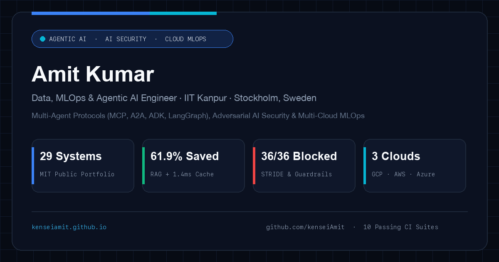

<div align="center">
  
  <br/><br/>
  <a href="https://kenseiamit.github.io"></a>
  <a href="https://github.com/kenseiAmit?tab=repositories"></a>
  <a href="mailto:kenseiamit@gmail.com"></a>
</div>

---

# Amit Kumar — Interactive Engineering Portfolio (`kenseiamit.github.io`)

Executive system-architecture showcase and interactive trace replay portfolio spanning **29 open-source production repositories** across **Multi-Agent Orchestration (MCP, A2A, Google ADK, LangGraph, Claude Agent SDK, Semantic Kernel)**, **Adversarial AI Security & EU AI Act Governance**, **Calibrated LLMOps**, and **Multi-Cloud MLOps (GCP · AWS · Azure)**.

### Shareable Role-Lens Deep Links

| Target Hiring Track | Direct Shareable Portfolio Link |
| :--- | :--- |
| **Executive Overview (All 29 Systems)** | [`https://kenseiamit.github.io/`](https://kenseiamit.github.io/) |
| **Agentic AI & MCP Protocols (16 Systems)** | [`https://kenseiamit.github.io/portfolio/?track=agentic-ai`](https://kenseiamit.github.io/portfolio/?track=agentic-ai) |
| **LLMOps, AgentOps & Calibration (9 Systems)** | [`https://kenseiamit.github.io/portfolio/?track=llmops`](https://kenseiamit.github.io/portfolio/?track=llmops) |
| **FinTech, AML & Quantitative AI (10 Systems)** | [`https://kenseiamit.github.io/portfolio/?track=fintech`](https://kenseiamit.github.io/portfolio/?track=fintech) |
| **AI Security, Red-Teaming & GRC (7 Systems)** | [`https://kenseiamit.github.io/portfolio/?track=ai-security`](https://kenseiamit.github.io/portfolio/?track=ai-security) |
| **Production MLOps & Data (9 Systems)** | [`https://kenseiamit.github.io/portfolio/?track=mlops`](https://kenseiamit.github.io/portfolio/?track=mlops) |
| **Multi-Cloud Architecture & SWE (12 Systems)** | [`https://kenseiamit.github.io/portfolio/?track=cloud`](https://kenseiamit.github.io/portfolio/?track=cloud) |

### Local Preview & Data Sync

```bash
# Re-compile data/portfolio.json & empirical telemetry assets from sibling repositories
python3 scripts/build_portfolio_data.py

# Preview locally
python3 -m http.server 8080
```

## License

MIT License — © Amit Kumar (`@kenseiAmit`).
